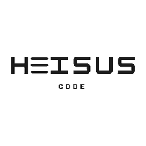
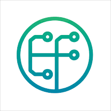

<div align="center">

<h1>Heitor Carvalho Ferreira</h1>

<p>
  <strong>Full Stack &nbsp;·&nbsp; Cibersegurança &nbsp;·&nbsp; Ciência de Dados &nbsp;·&nbsp; Redes de Computadores</strong>
</p>

<p>
  Estudante da Escola do Futuro de Goiás &nbsp;·&nbsp; Fundador da HeisusCode<br>
  <em>Construindo sistemas eficientes que resolvem problemas reais.</em>
</p>

<br>

<a href="mailto:heitorcf10@gmail.com">
  
</a>
&nbsp;
<a href="https://linkedin.com/in/heitorcarvalhoferreira">
  
</a>
&nbsp;
<a href="https://wa.me/5561994613752">
  
</a>
&nbsp;
<a href="https://heisuscode.dev">
  
</a>
&nbsp;
<a href="https://github.com/Ferre1ra10">
  
</a>

<br><br>


&nbsp;

&nbsp;


</div>


## 👨‍💻 Sobre

Olá! Meu nome é **Heitor Carvalho Ferreira**. Sou participante do programa **Jornada para o Futuro**, com formação em Desenvolvimento Web e Cibersegurança, estudante de Ciência de Dados e Técnico em Redes, além de fundador da **HeisusCode**.

Desenvolvo aplicações web, APIs, sistemas de gestão e soluções baseadas em dados, utilizando tecnologias modernas e boas práticas de segurança.

Realizei um intercâmbio acadêmico na Inglaterra, na **University of Sussex**, onde concluí o curso **General English – CEFR A2**, pela St Andrew's College Language Schools.

Também concluí a formação **Network Technician Career Path**, pela **Cisco Networking Academy**, ampliando meus conhecimentos em infraestrutura, protocolos, segurança e administração de redes.

Atualmente, busco oportunidades profissionais em desenvolvimento de software, ciência de dados, redes e cibersegurança.

```yaml
foco:      [ sistemas reais, ciência de dados, IA aplicada, segurança digital ]
atuação:   [ frontend, back-end & APIs, análise de dados, automação ]
dados:     [ Python, Pandas, SQL, visualização e dashboards ]
redes:     [ TCP/IP, IPv4, IPv6, DNS, DHCP, roteamento, switching ]
segurança: [ segurança de redes, controle de acesso, boas práticas ]
objetivo:  primeira oportunidade profissional em tecnologia
```

<br clear="all"/>


## 🧭 Áreas de atuação

| Área | O que eu faço |
| :--- | :--- |
| 🌐 **Desenvolvimento Web** | Sistemas web completos, do frontend à API |
| 📊 **Ciência de Dados** | Coleta, limpeza, tratamento de dados, análise exploratória e dashboards com Python, Pandas e SQL |
| 🤖 **Inteligência Artificial** | IA aplicada a projetos reais, utilizando modelos inteligentes e automação |
| 🔐 **Cibersegurança** | Segurança digital, controle de acesso e boas práticas de desenvolvimento |
| 🌍 **Redes de Computadores** | Configuração de redes, endereçamento IPv4/IPv6, roteamento e comutação |
| 🛠️ **Infraestrutura de TI** | Administração de redes, DNS, DHCP, suporte técnico e diagnóstico de conectividade |
| ⚙️ **Automação** | Automação de processos e integração entre sistemas |


## 🧰 Stack

<table width="100%">
  <tr>
    <td width="50%" valign="top" align="center">
      <strong>💻 Principais habilidades</strong>
      <br><br>
      
    </td>
    <td width="50%" valign="top" align="center">
      <strong>🛠️ Ferramentas</strong>
      <br><br>
      
    </td>
  </tr>
</table>

<div align="center">

<br>

<strong>📚 Estudando agora</strong>

<br><br>


</div>

<br>


## 🚀 Projetos Desenvolvidos

<table width="100%">
  <tr>
    <td width="50%" valign="top" align="center">
      <h3>🖥️ <a href="https://heisuscode.dev">HeisusCode</a></h3>
      <p><em>Desenvolvimento Web e Cibersegurança</em></p>
      <p align="left">
        Soluções web e sistemas sob medida para empresas, do frontend à API, com foco em performance, segurança e presença digital profissional.
      </p>
      
      
      
    </td>
    <td width="50%" valign="top" align="center">
      <h3>🏥 Sistema de Gestão Hospitalar</h3>
      <p><em>Plataforma Full Stack · TCC em desenvolvimento</em></p>
      <p align="left">
        Gestão hospitalar com módulo de agendamento de consultas e controle financeiro, voltada à organização de dados clínicos e automação de processos.
      </p>
      
      
      
    </td>
  </tr>
  <tr>
    <td width="50%" valign="top" align="center">
      <h3>💰 MoneyControl</h3>
      <p><em>Gestão Financeira Pessoal</em></p>
      <p align="left">
        Aplicação para controle de finanças pessoais, com registro de receitas e despesas e visualização clara dos gastos.
      </p>
      
      
    </td>
    <td width="50%" valign="top" align="center">
      <h3>🤖 JARVIS</h3>
      <p><em>Assistente de IA Personalizado</em></p>
      <p align="left">
        Assistente de inteligência artificial próprio, com foco em automação de tarefas e integração de sistemas do dia a dia.
      </p>
      
      
    </td>
  </tr>
</table>

<div align="center">

<a href="https://github.com/Ferre1ra10?tab=repositories">
  
</a>

</div>

<br>


## 💼 Experiências

Minha trajetória profissional, acadêmica e minhas certificações mais recentes.

<br>

<a href="https://heisuscode.dev">
  
</a>

**Fundador · Desenvolvimento Web** <br>
[**HeisusCode**](https://heisuscode.dev) • Atual <br>
Foco: `Sites e Sistemas Web`, `Frontend & APIs`, `Performance`, `Segurança` <br>
Site: [heisuscode.dev](https://heisuscode.dev)

<br clear="left">
<br>


**Intercâmbio Internacional** <br>
**University of Sussex, Brighton** • Jul/2026 <br>
Curso: `General English – CEFR A2` • `60 horas` <br>
Instituição: `St Andrew's College Language Schools` <br>
Foco: `Imersão Internacional`, `Língua Inglesa`, `Comunicação`

<br clear="left">
<br>



**Técnico em Desenvolvimento Web e Cibersegurança** <br>
**Escola do Futuro de Goiás** • Formação técnica <br>
Foco: `Desenvolvimento Web`, `Cibersegurança`, `Lógica de Programação` <br>
Tecnologias: `HTML`, `CSS`, `JavaScript`, `React`, `Node.js` <br>
Projetos: [HeisusCode](https://heisuscode.dev)

<br clear="left">
<br>


**Técnico em Redes de Computadores** <br>
**Escola do Futuro de Goiás** • Cursando <br>
Foco: `Infraestrutura de Redes`, `Administração de Redes`, `Segurança de Redes` <br>
Conhecimentos: `TCP/IP`, `IPv4/IPv6`, `Roteamento`, `Switching`, `DNS`, `DHCP` <br>
Áreas: `Suporte Técnico`, `Conectividade`, `Diagnóstico de Redes`

<br clear="left">
<br>


**Digital Safety and Security Awareness** <br>
**Cisco Networking Academy** • Certificado (set/2026) <br>
Foco: `Segurança Digital`, `Conscientização em Cibersegurança`, `Operações Cibernéticas` <br>
Área: `Cybersecurity Awareness`

<br clear="left">
<br>


**Network Technician Career Path** <br>
**Cisco Networking Academy** • Certificado (nov/2026) <br>
Foco: `Redes de Computadores`, `TCP/IP`, `IPv4/IPv6`, `Roteamento`, `Switching` <br>
Competências: `Network Administration`, `Network Security`, `Network Troubleshooting` <br>
Conhecimentos: `DNS`, `DHCP`, `Ethernet`, `Configuração de Roteadores`

<br clear="left">
<br>

<a href="https://www.dio.me/">
  
</a>

**Bootcamp** <br>
[**DIO**](https://www.dio.me/) • Formação <br>
Linguagens & Tecnologias: `TypeScript`, `Node.js`, `JavaScript`, `Inteligência Artificial` <br>
Portfólio: [GitHub](https://github.com/Ferre1ra10)

<br clear="left">
<br>


**Técnico em Ciência de Dados** <br>
**Escola do Futuro de Goiás** • Cursando <br>
Previsão de conclusão: `Junho de 2027` <br>
Foco: `Python`, `Pandas`, `SQL`, `Análise e Tratamento de Dados` <br>
Projetos: `Dashboards`, `Análise Exploratória`, `Gestão de Dados`

<br clear="left">
<br>


<div align="center">

<sub>Focado em criar soluções tecnológicas que geram impacto real.</sub>

</div>
